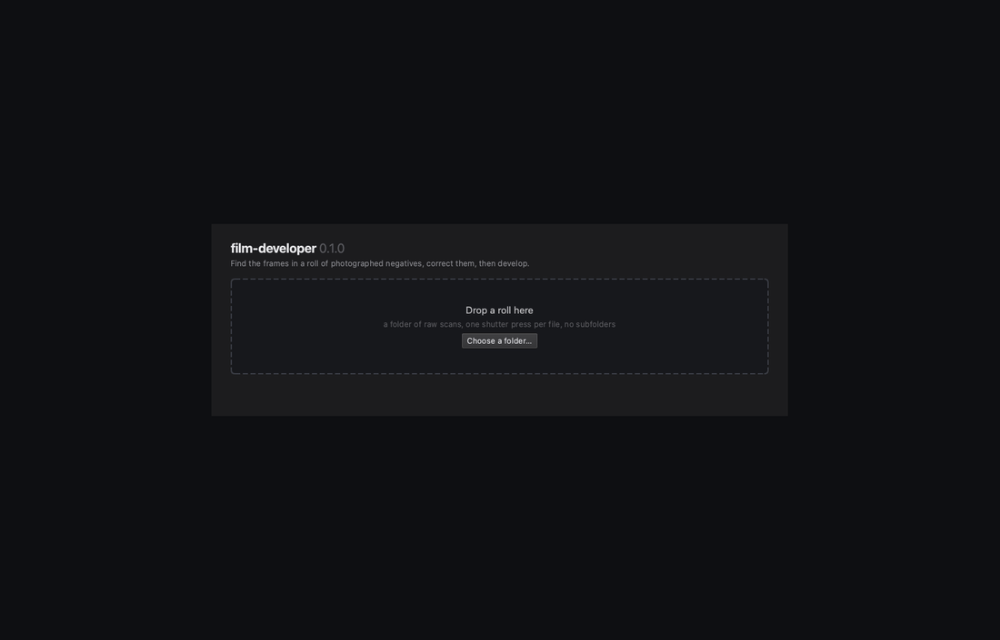
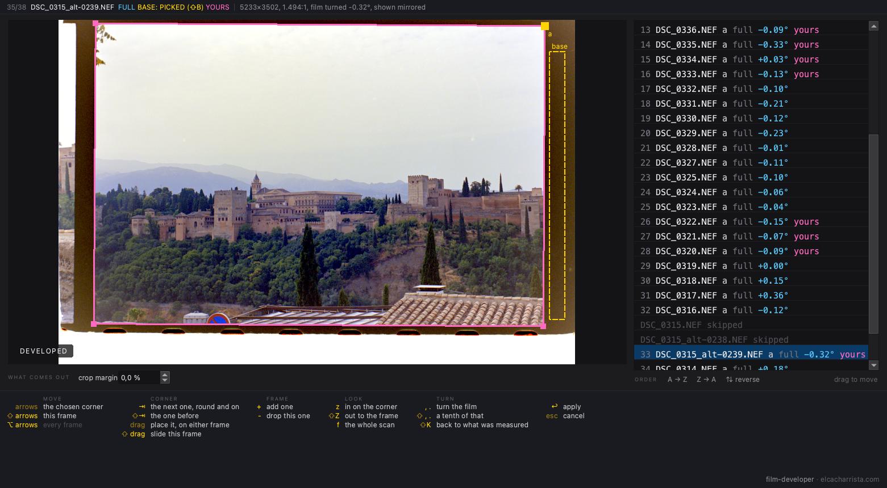
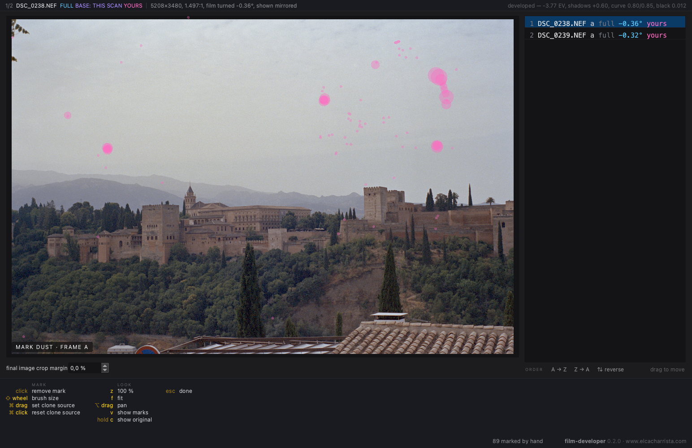
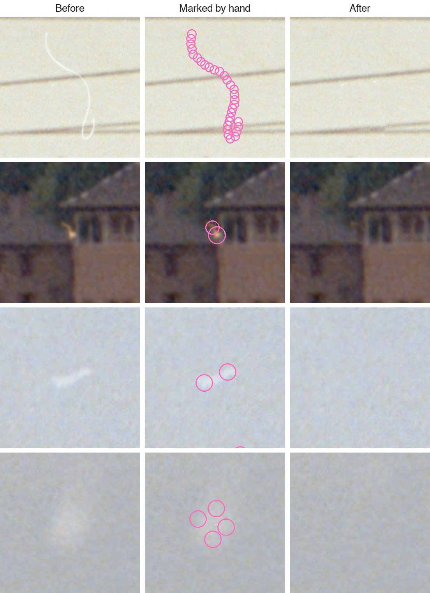
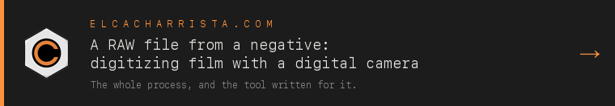

# film-developer

A desktop app to digitise photographic film negatives with a digital camera.

I scan my 35mm negatives with a camera on a copy stand, over a light table.
Each raw file has more than the photo: the film border, the sprocket holes,
the negative holder, the light table, and the frame is usually tilted by a
degree or two. I built film-developer to turn a folder of these scans (one
roll) into finished photos. It finds every frame, including half-frame
pairs, straightens and crops it, and inverts the orange negative into a
positive. You check the roll in the app, fix what is wrong, and export.

<p align="center">
  
</p>

## What you get

- **Developed photos**, as JPEG (the default) or 16-bit TIFF. Each frame is
  inverted against the film base, and the colour balance is measured over
  the whole roll.
- **Positive raw files (DNG).** The negative is inverted on the raw Bayer
  data, before demosaicing, so another raw developer can open the file and
  edit it like a normal camera raw. I tested them in DaVinci Resolve and in
  the raw engine built into macOS. The white balance is set so that 5600 K
  with no tint is the roll's neutral. The DNGs use lossless compression by
  default.
- Optionally, **the cropped negatives**, not inverted.

The dust you mark is always removed from the developed photos. Removing it
from the DNGs too is an option when you export, off by default.

The output files start with the shot number, so sorted by name they are in
the order the roll was shot. The app never writes over your original scans.

## Install

Download it from the
[latest release](https://github.com/jahurtado/film-developer/releases/latest):

- **macOS** (Apple Silicon): `film-developer-VERSION-arm64.dmg`
- **Windows** (x64): the installer `film-developer-VERSION-x64-setup.exe`,
  or the portable `film-developer-VERSION-x64.zip` (unpack it and run
  `film-developer.cmd`)

The checksums are in `SHA256SUMS`. Each download includes Python and all the
libraries, so you don't need to install anything else.

The apps are not signed, so macOS and Windows show a warning the first time
you open them. On macOS, go to System Settings → Privacy & Security and
click *Open Anyway*. On Windows, click *More info* and then *Run anyway*.

The Windows installer has not been tested on a Windows machine yet.

On an Intel Mac or on Linux, run it from source.

## Run from source

You need [uv](https://docs.astral.sh/uv/) and Python 3.10 or newer. There is
nothing to build:

```sh
git clone https://github.com/jahurtado/film-developer.git
cd film-developer
./film-developer
```

The first run sets up the environment with `uv run` and then opens the
window. To build the desktop apps yourself, see
[packaging/README.md](packaging/README.md).

## How to use it

1. **Open a folder of scans.** Drag it onto the window, or choose it. The
   app reads camera raw files: NEF, CR2, CR3 and DNG.
2. **Answer a few questions about the folder**: are all the scans from the
   same roll, is every frame the same size, is the film base the same across
   the roll, and which light falloff calibration to use, if you have one.
   Then the app measures the roll on all CPU cores. This takes a minute or
   two.
3. **Check the roll.** The first photo opens already developed. `n` and `p`
   move through the roll. `v` switches between the raw scan, the plain
   positive and the developed photo. `space` shows only the frame. The list
   marks the frames where the detection is not sure. If the colours are
   off, `⇧B` picks the film base on a scan, for that scan or for the whole
   roll.
4. **Fix what is wrong.** `e` lets you move the frame corners by hand. `r`
   rotates a photo, `del` leaves a scan out, and you can drag scans in the
   list to put them in shot order. Your manual changes are kept if you
   measure the roll again.
5. **Mark dust**, if you want. `s` shows the frame developed at full size.
   Click on a speck or drag along a scratch to paint over it, and it is
   removed from the developed photo. Hold `c` to see the original.
6. **Set the look of the roll** with `⌘L`, with a frame on screen: exposure,
   warmth, tint, contrast, saturation, noise reduction, sharpening and a few
   more. You can check noise reduction and sharpening at 100 %.
7. **Process** with `⌘R`. Choose developed photos, raw DNGs, or both.
   `⇧⌘R` processes only the photo on screen.

The bottom of the window lists the keys for the current mode, grouped by
area: view, crop, colour, dust and process.

<p align="center">
  
  &nbsp;
  
  <br>
  <sub>Placing a frame by hand (<code>e</code>) and marking dust (<code>s</code>).</sub>
</p>

A click paints a round dab and a drag paints a stroke, both with the brush
size you set with `⇧` and the mouse wheel. You can change the size of a dab
or a stroke after you make it. The app fills what you painted from the
picture around it.

<p align="center">
  
  <br>
  <sub>Before, the marks, and the developed photo. A hair across two wires, then three on a frame of the Alhambra: a fibre by a window, a fibre in the sky, and a soft blur of dust.</sub>
</p>

## How it works

**Finding the frame.** The app searches for the rectangle that best fits the
frame. It looks for two kinds of pixels that are never part of the photo:
light coming straight through the holder, and the opaque holder itself. Then
it moves each side to the innermost edge that runs along the whole side. All
the frames of a roll come from one camera, so the roll is measured twice, and
the second time the app uses the frame size from the first. When the sprocket
holes are in the scan, they give the scale and the position. On 35mm film
the holes are 4.75 mm apart, and the camera advances the film by the same
number of holes every time, so each frame starts at the same point between
the holes. I tested the detection on 98 scans that I had cropped by hand,
from four rolls and two cameras. It got 97 right, and it flagged the one it
got wrong.

**Developing.** Each frame is divided by the film base, which is the colour
of unexposed film. The app reads it from the film border, limits it by the
frame's own shadows, or you can pick it by hand (`⇧B`). Then it undoes the
film's curve. The film base and the colour balance are measured over the
whole roll. The exposure and contrast of each frame follow fixed rules. The
look you set with `⌘L` applies to the whole roll. You can also calibrate the
light falloff of your copy stand once, from a few blank shots (`⇧⌘L`), and
use it for every roll you scan on that setup.

For each scan, the app saves what it decided and the measurements behind it
in `frames.json`, a readable file in the folder of scans.

[](https://www.elcacharrista.com/en/articles/digitizing-film-negatives-with-a-camera/)

## Licence

GPL-3.0-or-later. The full text is in [LICENSE](LICENSE). I chose this
licence; the dependencies don't require it. They are LGPL (Qt, LibRaw) and
BSD/MIT, and none of them is GPL. The desktop apps include these libraries,
and [THIRD-PARTY-LICENSES.md](THIRD-PARTY-LICENSES.md) lists them and where
to get their source.
